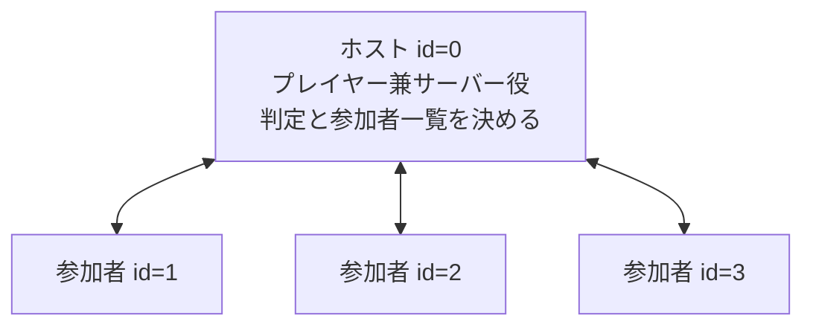
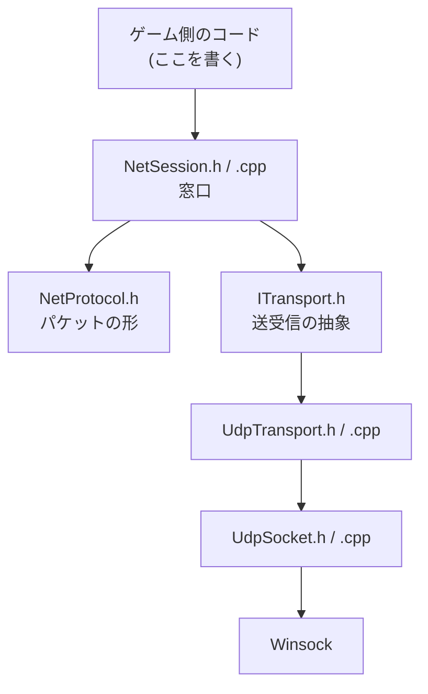

# game-udp-net

ゲームにオンライン対戦を組み込むための通信モジュールです。
最大 4 人(1 対 1 〜 1 対 3)、ホスト型、UDP。Winsock だけで作っていて、DirectX には依存しません。

**この 3 つを覚えれば使えます。**

1. 毎フレーム `Update()` を呼ぶ
2. 自分の状態を `SetLocalState()` で渡す
3. 他の人の状態を `GetPlayers()` で受け取って描画する

---

## 目次

1. [接続の形](#1-接続の形)
2. [ファイル構成 ― どれを触るか](#2-ファイル構成--どれを触るか)
3. [プロジェクトへの導入](#3-プロジェクトへの導入)
4. [最小の組み込み方](#4-最小の組み込み方)
5. [**新しい機能の足し方**](#5-新しい機能の足し方)
6. [通信モジュール自体を変えるとき](#6-通信モジュール自体を変えるとき)
7. [知っておいてほしいこと](#7-知っておいてほしいこと)
8. [チームで決めること](#8-チームで決めること)
9. [動作確認と、つながらないとき](#9-動作確認と-つながらないとき)
10. [今できないこと](#10-今できないこと)

---

## 1. 接続の形



- **参加者同士は直接つながりません。** すべてホストを経由します
- 参加者は自分の状態をホストに送り、ホストが全員分をまとめて配ります
- **当たり判定・アイテム取得・スコアは、ホストが決めます**(人によって結果が食い違わないため)

### 送っているもの

| 種類 | 頻度 | 消えたとき |
|---|---|---|
| 位置・向き・`custom`(64 バイト) | 毎秒 30 回 | 送り直さない。次がすぐ来るため |
| イベント・参加者一覧 | 必要なときだけ | 届くまで送り直す。順番も守られる |

---

## 2. ファイル構成 ― どれを触るか



| ファイル | 役割 | ゲーム側が触るか |
|---|---|---|
| **`NetSession.h`** | 窓口。型と関数の一覧 | **include する。上限値を変えるときだけ編集** |
| `NetSession.cpp` | 本体の処理 | 触らない(新しいパケット種別を作るとき以外) |
| `NetProtocol.h` | パケットの形、バイト列の読み書き | 触らない |
| `ITransport.h` | 送受信の抽象インターフェース | 触らない |
| **`UdpTransport.h` / `.cpp`** | Winsock 版の送受信 | **初期化で include する** |
| `UdpSocket.h` / `.cpp` | Winsock を直接呼ぶ唯一の場所 | 触らない |
| `NetTypes.h` | 共通の型。人数の上限 | 人数を変えるときだけ編集 |
| `main.cpp` | 動作確認ツール | 組み込みの見本として読む |

**ゲーム側が `#include` するのは `NetSession.h` と `UdpTransport.h` の 2 つだけです。**

---

## 3. プロジェクトへの導入

`main.cpp` 以外の 9 ファイルをプロジェクトに追加し、次の設定をしてください。

| 設定 | 場所 | 値 |
|---|---|---|
| C++ のバージョン | C/C++ → 言語 → C++ 言語標準 | **ISO C++17 (/std:c++17)** |
| 文字コード | C/C++ → コマンドライン → 追加オプション | **/utf-8** |

- **C++17 にしないと** `C2429` のエラーでビルドできません
- **/utf-8 がないと** 日本語コメントで `C4819` の警告や、おかしなエラーが出ます
- **すべての構成**(Debug / Release、x64 / x86)に設定してください

`ws2_32.lib` のリンクはコード内で指定済みです。

---

## 4. 最小の組み込み方

### 初期化(ゲーム開始時に 1 回)

```cpp
#include "NetSession.h"
#include "UdpTransport.h"

WinsockContext    winsock;      // ← この順番で作る。逆にするとクラッシュします
net::UdpTransport transport;

// ホストになる場合
transport.Open(50000);                      // ポート番号はチームで決めた値
net::NetSession session(transport);
session.Host();

// 参加する場合
transport.Open(0);                          // 0 = 番号を OS に選ばせる
net::NetSession session(transport);
net::NetAddress host;
net::UdpTransport::MakeAddress("192.168.0.10", 50000, host);
session.Join(host);
```

`Join()` が `true` でも、まだつながっていません。結果は `Connected` / `Disconnected` イベントで届きます。

### 毎フレーム

```cpp
// ---- ① 通信 ----
session.Update();

// ---- ② 出来事を受け取る (false になるまで必ず全部) ----
net::NetEvent e;
while (session.PollEvent(e))
{
    switch (e.type)
    {
    case net::NetEventType::Connected:    /* e.player = 自分の ID */        break;
    case net::NetEventType::Disconnected: /* e.reason = 理由 */             break;
    case net::NetEventType::PlayerJoined: /* e.player が参加 → キャラを出す */ break;
    case net::NetEventType::PlayerLeft:   /* e.player が退出 → キャラを消す */ break;
    case net::NetEventType::MatchStarted: /* 試合開始 */                     break;
    case net::NetEventType::MatchEnded:   /* 試合終了 */                     break;
    case net::NetEventType::GameEvent:    /* 5 章を参照 */                   break;
    default: break;
    }
}

// ---- ③ 自分の状態を渡す ----
net::PlayerState state;
state.transform.position[0] = myPos.x;
state.transform.position[1] = myPos.y;
state.transform.position[2] = myPos.z;
state.transform.rotation[0] = myRot.x;
state.transform.rotation[1] = myRot.y;
state.transform.rotation[2] = myRot.z;
state.transform.rotation[3] = myRot.w;
state.SetCustom(PlayerSync{ hp, animId });
session.SetLocalState(state);

// ---- ④ 全員を描画 ----
std::array<net::PlayerInfo, net::kMaxPlayers> players;
const int count = session.GetPlayers(players);
for (int i = 0; i < count; ++i)
{
    const net::PlayerInfo& p = players[i];
    if (p.isLocal)   { continue; }   // 自分は自分のゲーム内の値で描く
    if (!p.hasState) { continue; }   // まだ状態が届いていない

    PlayerSync sync;
    p.state.GetCustom(sync);
    DrawPlayer(p.id, p.state.transform, sync);   // 位置と向きは補間済み
}
```

### 終了時

```cpp
session.Leave();    // 相手の画面からすぐ消える(呼ばなくても自動で実行される)
```

---

## 5. 新しい機能の足し方

**ほとんどの場合、通信モジュールは触りません。** 足すのはゲーム側のコードだけです。

### 5.1 まず分ける ― 状態か、出来事か

> **「その情報が 1 回届かなかったとき、次のフレームで分かるか?」**

| 答え | 分類 | どこに足すか | 例 |
|---|---|---|---|
| 分かる | **状態** | `custom` にメンバを足す | HP、アニメ番号、しゃがみ中、持ち物 |
| 分からない | **出来事** | イベントを足す | 攻撃した、拾った、ドアを開けた |

### 5.2 状態を足す(例: ダッシュ中かどうかを見せたい)

**使うもの**: `net::PlayerState::SetCustom` / `GetCustom`(`NetSession.h`)
**触るファイル**: 共有ヘッダ + 送る所と描く所だけ

**① 共有ヘッダ(`GameNetTypes.h`)の構造体にメンバを足す**

```cpp
struct PlayerSync
{
    std::uint8_t hp;
    std::uint8_t animId;
    std::uint8_t flags;      // ← 追加 (bit0 = ダッシュ中、bit1 = しゃがみ中)
};
```

**② 送る側**(すでに `SetCustom` しているので、値を入れるだけ)

```cpp
sync.flags = (isDashing ? 1 : 0) | (isCrouching ? 2 : 0);
state.SetCustom(sync);
```

**③ 受け取る側**

```cpp
PlayerSync sync;
p.state.GetCustom(sync);
DrawPlayer(p.id, p.state.transform, sync.flags & 1);
```

**守ること**

- **合計 64 バイトまで**。超えるとビルドエラーになります
- **ポインタ・`std::string`・`std::vector` は入れられません**(ビルドエラー)
- **構造体を変えたら、全員が同じ exe を使う。** 古い exe が混ざると、エラーにならずに値が壊れます

### 5.3 出来事を足す(例: 攻撃してダメージを与えたい)

**使うもの**: `session.SendGameEvent()` / `e.gameEventType` / `e.Read()`(`NetSession.h`)
**触るファイル**: 共有ヘッダ + 送る所 + イベントを受け取る所

攻撃は他人に影響するので、**ホストが判定します**。

**① 共有ヘッダに番号と構造体を追加**

```cpp
constexpr std::uint16_t kEventAttackRequest = 10;   // 参加者 → ホスト「攻撃したい」
constexpr std::uint16_t kEventDamage        = 11;   // ホスト → 全員「ダメージが入った」

struct AttackRequest { std::uint8_t targetId; };
struct DamageResult  { std::uint8_t targetId; std::uint8_t newHp; };
```

**② 攻撃ボタンを押したとき**

```cpp
session.SendGameEvent(kEventAttackRequest, AttackRequest{ targetId },
                      net::EventTarget::HostOnly);
```

**③ イベントを受け取る所(`GameEvent` の case)に足す**

```cpp
case net::NetEventType::GameEvent:
    // --- ホストだけが判定する ---
    if (session.IsHost() && e.gameEventType == kEventAttackRequest)
    {
        AttackRequest req;
        if (e.Read(req) && CanAttack(e.player, req.targetId))   // 距離・無敵時間を確認
        {
            const int hp = ApplyDamage(req.targetId, 10);
            session.SendGameEvent(kEventDamage,
                                  DamageResult{ req.targetId, (std::uint8_t)hp });  // 全員へ
        }
    }

    // --- 結果は全員が同じように処理する(ホストも含む) ---
    if (e.gameEventType == kEventDamage)
    {
        DamageResult dmg;
        if (e.Read(dmg))
        {
            SetHp(dmg.targetId, dmg.newHp);
            PlayHitEffect(dmg.targetId);
        }
    }
    break;
```

**ホスト自身も結果イベントを受け取って処理します。** そうすると、ホスト用と参加者用でコードが分かれません。

**守ること**

- **1 つにつき 256 バイトまで**
- **ポインタや `std::string` は入れられません**
- **送れるのは参加した後(ロビーか試合中)だけ**。戻り値が `false` なら送られていません
- 番号は**共有ヘッダ 1 つにまとめて管理**してください

### 5.4 誰が判定するか

| 内容 | 判定する人 | 送り方 |
|---|---|---|
| 自分の位置・向き・見た目 | 本人 | `custom` に入れるだけ |
| ジャンプの音など、見た目だけのもの | 本人 | `All` でそのまま送る |
| ダメージ、アイテム取得、スコア、勝敗 | **ホスト** | 依頼を `HostOnly` → 結果を `All` |

**迷ったらホストに決めさせてください。**

### 5.5 ここまでのまとめ

| やりたいこと | 触るファイル |
|---|---|
| 同期する値を増やす | 共有ヘッダ、自分のゲームのコード |
| 新しいイベントを足す | 共有ヘッダ、自分のゲームのコード |
| **通信モジュール** | **触らない** |

---

## 6. 通信モジュール自体を変えるとき

5 章で足りないときだけ、ここを見てください。

### 設定を変えるだけでよいもの(ファイルの編集は不要)

`net::SessionConfig`(`NetSession.h`)を作って `NetSession` に渡します。

```cpp
net::SessionConfig config;
config.stateSendRate      = 60.0;   // 送る回数 (回/秒)。初期値 30
config.interpolationDelay = 0.15;   // 補間の遅れ (秒)。初期値 0.1
config.timeoutSeconds     = 5.0;    // 切断までの時間 (秒)。初期値 3
config.allowJoinInMatch   = true;   // 試合中の途中参加を許す。初期値 false

net::NetSession session(transport, config);
```

**全員が同じ設定にしてください。** 送る回数だけ違うと、人によって見え方が変わります。

### 定数を変えるもの

| やりたいこと | ファイル | 変える場所 | 注意 |
|---|---|---|---|
| 同期する値を 64 バイト超にする | `NetSession.h` | `kMaxCustomStateSize` | 人数 × この値がパケットに収まること |
| イベントを 256 バイト超にする | `NetSession.h` | `kMaxEventPayloadSize` | 512 バイトまで |
| 人数を増やす | `NetTypes.h` | `kMaxPlayers` | 通信量が人数に比例して増える |

**どれも、変えたら `NetProtocol.h` の `kProtocolVersion` を 1 つ上げてください。**
古い exe とつながらなくなり、値が壊れたまま動く事故を防げます。

### 機能を足すもの(作業が大きい)

| やりたいこと | 触る場所 |
|---|---|
| 新しいパケットの種類を足す | `NetProtocol.h` の `MsgType` に追加 → `NetSession.cpp` の `HandleHostPacket()` / `HandleClientPacket()` の `switch` に `case` を追加 → 送信関数を作る |
| 確実に届くメッセージの種類を足す | `NetProtocol.h` の `ReliableKind` に追加 → `NetSession.cpp` の `ProcessReliableBody()` に追加 |
| 大きなデータの分割送信(画像など) | `NetSession.h` / `.cpp` に、分割と組み立ての仕組みを新規に追加 |
| プレイヤー以外の物を毎フレーム同期(動く敵など) | `SendWorldState()` / `HandleWorldState()`(`NetSession.cpp`)を拡張 |
| Steam 対応(インターネット越し) | `ITransport` を継承した新しいクラスを作る。**`NetSession` は変更不要** |

この表に当てはまるものが出てきたら、**先に相談してください。**

---

## 7. 知っておいてほしいこと

### 他のプレイヤーは 0.1 秒前の姿

なめらかに見せるため、他のプレイヤーは**わざと 0.1 秒ほど遅らせて**表示しています。

- **他のプレイヤーへの当たり判定を、自分の PC でしないでください。** 見えている位置とホストが持っている位置は違います
- **自分のキャラは遅れません。** 入力どおりにすぐ動かして大丈夫です

### 使える関数

| 関数 | 戻り値 |
|---|---|
| `session.State()` | `Idle` / `Connecting` / `Lobby` / `InMatch` / `Disconnected` |
| `session.IsHost()` | 自分がホストか |
| `session.LocalPlayerId()` | 自分の ID(0 = ホスト) |
| `session.PlayerCount()` | 今の人数 |
| `session.GetPlayer(id, out)` | ID を指定して 1 人分を取る |
| `session.SetTeam(id, team)` | 陣営を決める(ホスト・ロビー中のみ) |
| `session.StartMatch()` / `EndMatch()` | 試合の開始 / 終了(ホストのみ) |

### やってはいけないこと

- **`Update()` を呼び忘れる** → 何も届かず、3 秒で切断されます
- **`PollEvent()` を途中でやめる** → 出来事がたまり続けます
- **別スレッドから呼ぶ** → 想定していません。メインスレッドから呼んでください
- **`transport` より先に `session` を作る** → 終了時にクラッシュします

---

## 8. チームで決めること

次の 2 つは、**共有ヘッダ(例: `GameNetTypes.h`)を 1 つ作って、そこに全部書いてください。**
バラバラに書くと、番号がぶつかったり構造体がずれたりして、原因の分かりにくい不具合になります。

### イベント番号の一覧

| 番号 | 名前 | 中身の構造体 | 宛先 | 誰が送る |
|---|---|---|---|---|
| 1 | | | All / HostOnly | |
| 2 | | | | |
| 3 | | | | |

### 毎フレーム同期する値(64 バイトまで)

| メンバ | 型 | バイト数 | 内容 |
|---|---|---|---|
| | | | |
| | | **合計** | |

---

## 9. 動作確認と、つながらないとき

### 1 台の PC で試す

`main.cpp` の確認ツールを使うと、1 台で最大 4 つ起動できます。

1. 1 つ目を起動して `h`(ホスト)
2. 残りを起動して `j`(参加)、IP は **Enter を押すだけ**(127.0.0.1)

| キー | 動作 |
|---|---|
| `g` | テスト用イベントを送る |
| `r` | 1 人側(Solo)を次の人に交代(ホストのみ) |
| `s` / `e` | 試合の開始 / 終了(ホストのみ) |
| `q` | 終了 |

### 2 台以上で試す

ホストの PC で `ipconfig` を実行し、**IPv4 アドレス**を参加側に入力します。

### つながらないとき

| 症状 | 原因 | 対処 |
|---|---|---|
| `Open failed: 10048` | そのポートを別のプログラムが使用中 | 前の exe が残っていないか確認。ホストは 1 つだけ |
| `Disconnected (JoinTimeout)` | ホストに届いていない | 下の 3 点を確認 |
| 1 台では動くが 2 台で動かない | ファイアウォールか、ネットワークが別 | 下の 3 点を確認 |

1. **IP が正しいか** — 2 台の IP の**先頭 3 つの数字が同じか**(例: `192.168.1.xx` 同士)
2. **ファイアウォール** — Windows セキュリティ → ファイアウォールによるアプリケーションの許可 → その exe の**「パブリック」にチェック**
3. **ネットワーク** — 学校や会社の Wi-Fi は機器同士の通信を禁止していることがあります。LAN ケーブルで直接つなぐか、スマホのテザリングで試してください

---

## 10. 今できないこと

ゲームの仕様を考えるときは、次の点に注意してください。

- **インターネット越しの対戦はできません**(今は同じ LAN の中だけ)
- **大きなデータは送れません**(1 つにつき 256 バイトまで)。画像の共有などは別の仕組みが必要です
- **プレイヤー以外の物は自動で同期されません**(動く敵や弾は、仕組みを足す必要があります)
- **ホストが抜けると試合が終わります**(引き継ぐ仕組みはありません)
- **最大 4 人です**

必要になりそうなものがあれば、早めに言ってください。
